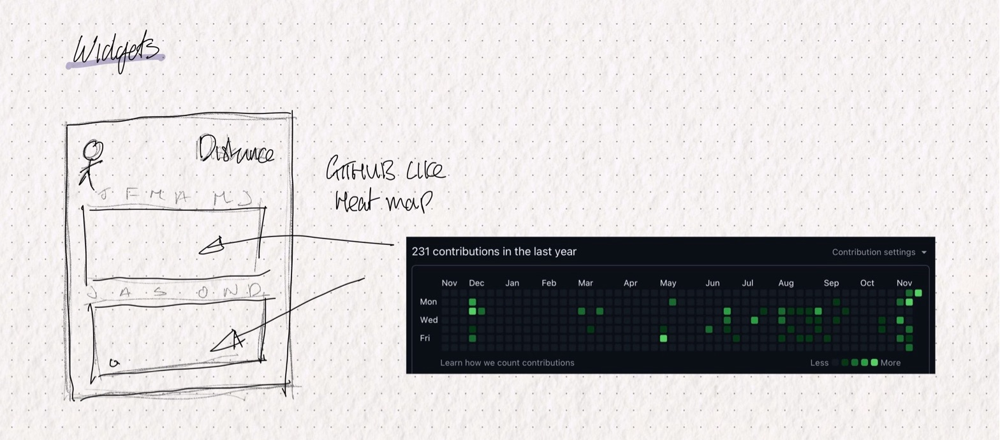

> "Create the things you wished existed."

[D!stance](/distancetracker/) is an app I wanted to exist. I wanted to be able to compare how far I'd walked and run, and I wanted widgets. But most of all, I wanted an app that I'd created on my phone.

I sat down and sketched what I wanted the app to do and how I wanted it to look. This is one of my sketches, for a widget with a heat map like the one on GitHub.

With my sketches, I planned with Claude how the app should function. Then I iterated and tested the app.

Here's how the widgets turned out, with the heat map at the bottom.

  <figure>
    
  </figure>

So far the process has been fun, and I have a few more ideas I want to add to the app. But for now, I'm pretty happy to have my app on my phone.
